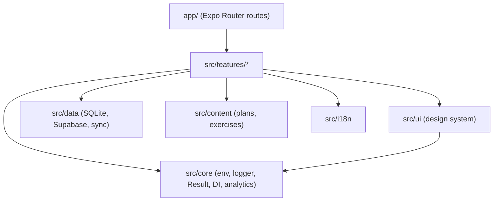

# FormFit

AI fitness coach for Android and iOS. Pick a plan, tap **Start today's workout**, and the phone
camera counts your reps, checks your form in real time and coaches you by voice — 100 % on-device.

> Status: **Phase 3 (Domain engine)** complete — geometry, One-Euro smoothing, 11 camera-tracked
> exercises with rep counting + form rules, exercise classifier, keyframes, replay harness
> (30 fixtures, 100 % rep accuracy). Device FPS numbers pending (see `docs/POSE_SPIKE.md`).
> See the phase plan in `claude-code-fitness-app-prompt.md` §7.2.

## Stack

Expo SDK 58 (React Native 0.88, New Architecture, dev builds) · TypeScript strict · Expo Router ·
Reanimated 4 + Gesture Handler · VisionCamera 5 + react-native-fast-tflite (BlazePose) · Skia ·
Zustand · i18next · zod · Jest + React Native Testing Library · ESLint + Prettier + Husky +
commitlint. Upcoming: expo-speech,
expo-sqlite + MMKV, Supabase, Sentry. Rationale in [`docs/DECISIONS.md`](docs/DECISIONS.md).

## Getting started

Requirements: Node 22+, Android Studio and/or Xcode for local dev builds (or EAS).

```bash
npm ci
cp .env.example .env        # all values optional for UI work
npm run android             # builds + installs a development client (Expo Go is NOT supported)
npm run ios
npm start                   # start Metro for an already-installed dev client
```

## Scripts

| Script                                | Purpose                           |
| ------------------------------------- | --------------------------------- |
| `start` / `android` / `ios`           | Metro / build & run dev client    |
| `lint`, `lint:fix`, `format`          | ESLint (zero warnings) / Prettier |
| `typecheck`                           | `tsc --noEmit`                    |
| `test`, `test:watch`, `test:coverage` | Jest                              |
| `test:e2e`                            | Maestro flows in `e2e/`           |
| `build:android`, `build:ios`          | EAS production builds             |
| `db:types`                            | Generate Supabase TS types        |
| `doctor`                              | `expo-doctor`                     |

Quality gate before every push: `npm run lint && npm run typecheck && npm test`.

## Architecture



Details: [`docs/ARCHITECTURE.md`](docs/ARCHITECTURE.md) · Design: [`docs/DESIGN_SYSTEM.md`](docs/DESIGN_SYSTEM.md) ·
Contributing: [`CONTRIBUTING.md`](CONTRIBUTING.md).

## Troubleshooting

- **"Expo Go" errors / missing native module** — FormFit needs a development build: `npm run android`.
- **Stale native config after changing `app.config.ts` or adding a native lib** — `npm run prebuild`, then rebuild.
- **Metro cache weirdness** — `npx expo start -c`.
- **Jest can't find a native module** — add a mock in `jest.setup.tsx`; worklets/reanimated are
  resolved to their JS fallbacks by `jest/resolver.js`.
- **`npm install` peer conflicts** — use `npx expo install <pkg>` so versions match SDK 58.

## Privacy

Camera frames are processed in memory on the device and never stored or uploaded.
