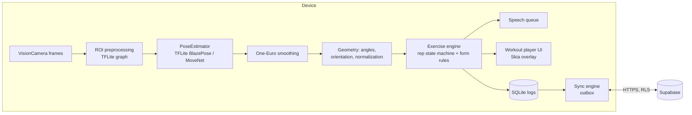

# Architecture

FormFit is an offline-first React Native (Expo SDK 58) app. All pose inference runs on-device;
no camera frames ever leave the phone.



## Layers

| Layer         | Path                                             | Rules                                                                                 |
| ------------- | ------------------------------------------------ | ------------------------------------------------------------------------------------- |
| Routes        | `app/`                                           | Thin Expo Router files; compose feature components                                    |
| Features      | `src/features/*`                                 | Feature UI + orchestration; may import `core`, `ui`, `data`, `content`, `i18n`        |
| Domain        | `src/features/{pose,exercises}/domain` (Phase 3) | Pure TS, no React/RN imports, 100 % unit-tested                                       |
| Data          | `src/data` (Phase 5)                             | Repositories, SQLite, Supabase client, sync engine                                    |
| Content       | `src/content` (Phase 7)                          | Plans + exercise catalog, zod-validated                                               |
| Design system | `src/ui`                                         | Tokens + components; no feature knowledge                                             |
| Core          | `src/core`                                       | env, logger, `Result`/`AppError`, feature flags, analytics interface, service locator |
| i18n          | `src/i18n`                                       | i18next; English source of truth, typed keys                                          |

## Dependency injection

`src/core/services.ts` holds interface-typed services (analytics today; PoseEstimator, SpeechService
and repositories as they land). Production implementations register at startup; tests call
`registerServices({...fakes})`.

## Error handling

Data/domain functions return `Result<T, AppError>` (`ok`/`err`, `tryAsync`). UI maps errors to
`ErrorState` / toasts. All logging goes through `logger` (Sentry sink added in hardening).

## Environment

Public config is parsed and validated with zod in `src/core/env.ts`; build-time values are read in
`app.config.ts`. See `.env.example`.

## Navigation map

```
/(tabs)        Today · Plans · Exercises · Progress · Settings   (custom animated tab bar)
/plan/[id]     Plan detail (slide)
/workout       Workout player (full-screen modal, fade, no swipe dismiss)
/dev/*         Dev-only tools (design-system gallery, pose lab + benchmark)
```

## Threads

| Thread                 | Work                                                                    |
| ---------------------- | ----------------------------------------------------------------------- |
| JS                     | React, navigation, model loading (`init()`), persistence                |
| Camera worklet runtime | frame → preprocessing graph → pose model → decode → `pose` shared value |
| UI (Reanimated)        | Skia skeleton paths, animations                                         |

Nothing per-frame touches React state; the debug HUD samples stats at ~2 Hz.
