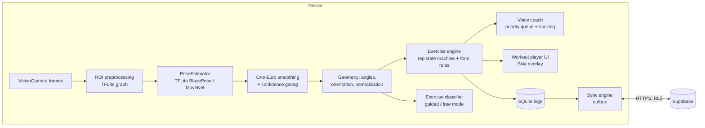
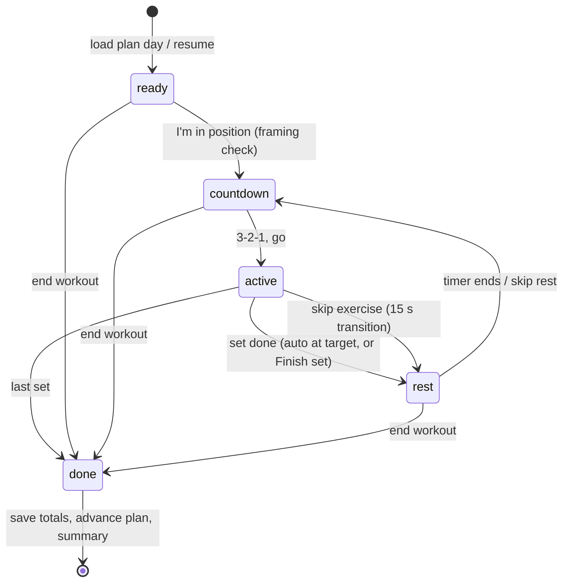

# Architecture

FormFit is an offline-first React Native (Expo SDK 58) app. All pose inference runs on-device;
no camera frames ever leave the phone.



## Layers

| Layer         | Path                    | Rules                                                                                 |
| ------------- | ----------------------- | ------------------------------------------------------------------------------------- |
| Routes        | `app/`                  | Thin Expo Router files; compose feature components                                    |
| Features      | `src/features/*`        | Feature UI + orchestration; may import `core`, `ui`, `data`, `content`, `i18n`        |
| Domain        | `src/features/*/domain` | Pure TS, no React/RN imports, 100 % unit-tested                                       |
| Data          | `src/data`              | Repositories, SQLite, Supabase client, sync engine, TanStack Query hooks              |
| Content       | `src/content`           | Plans (compiled to day-by-day schedules) + exercise catalog, zod-validated            |
| Design system | `src/ui`                | Tokens + components; no feature knowledge                                             |
| Core          | `src/core`              | env, logger, `Result`/`AppError`, feature flags, analytics interface, service locator |
| i18n          | `src/i18n`              | i18next; English source of truth, typed keys                                          |

## Dependency injection

`src/core/services.ts` holds interface-typed services (analytics today; PoseEstimator, SpeechService
and repositories as they land). Production implementations register at startup; tests call
`registerServices({...fakes})`.

## Error handling

Data/domain functions return `Result<T, AppError>` (`ok`/`err`, `tryAsync`). UI maps errors to
`ErrorState` / toasts. All logging goes through `logger` (Sentry sink added in hardening).

## Environment

Public config is parsed and validated with zod in `src/core/env.ts`; build-time values are read in
`app.config.ts`. See `.env.example`.

## Navigation map

```
/onboarding        First run: goal, level, equipment, days, permissions, safety, plan (gate in (tabs))
/(tabs)            Today · Plans · Exercises · Progress · Settings   (custom animated tab bar)
/plan/[id]         Plan detail: schedule by week, sample session, start/switch (slide)
/exercise/[id]     Exercise guide: animated demo, steps, cues, mistakes, variations (slide)
/workout           Player (full-screen modal, fade, no swipe dismiss) ?mode=plan|free&day=&resume=
/workout/summary   Session summary (?id=), confetti, personal bests, share
/auth/sign-in      Account / guest (modal)
/legal/[doc]       privacy · terms · disclaimer summaries
/dev/*             Dev-only tools (design-system gallery, pose lab + benchmark)
```

## Features

| Feature                     | Responsibility                                                                  |
| --------------------------- | ------------------------------------------------------------------------------- |
| `onboarding`                | Saves the profile, starts the recommended plan, sets reminders                  |
| `plans`                     | Schedule maths (today, week strip, progress, recommendation) + enrollment hooks |
| `workout-session`           | Player state machine (pure), steps from a plan day, persistence hook, summary   |
| `exercises`                 | Engine, classifier, keyframe demos (`ExerciseDemo`), live engine hook           |
| `history`                   | Chart series, heatmap, per-exercise trends (pure)                               |
| `reminders`                 | Pure reminder planning + expo-notifications scheduling (`ReminderScheduler`)    |
| `settings`, `voice`, `auth` | Preferences (synced), voice coach, accounts                                     |

## Workout player



Every finished set is written immediately (`workout_sets`), so a crash or "save and finish later"
can resume at the next set from Today. Pause (button or app backgrounded) freezes all timers.

## Threads

| Thread                 | Work                                                                                              |
| ---------------------- | ------------------------------------------------------------------------------------------------- |
| JS                     | React, navigation, model loading (`init()`), persistence, exercise engine (event-driven, ADR-029) |
| Camera worklet runtime | frame → preprocessing graph → pose model → decode → `pose` shared value                           |
| UI (Reanimated)        | Skia skeleton paths, animations                                                                   |

Nothing per-frame touches React state; the debug HUD samples stats at ~2 Hz.
