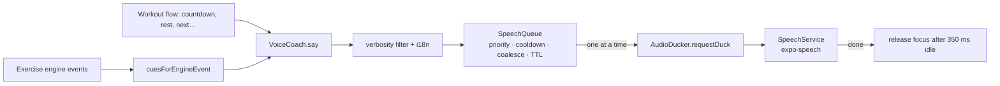

# Voice coach

Hands-free coaching: rep counts, form corrections and session prompts are spoken, translated, never
overlap, never nag, and duck (not stop) the user's music.

| Code                                         | Role                                                                              |
| -------------------------------------------- | --------------------------------------------------------------------------------- |
| `src/features/voice/domain/cueCatalog.ts`    | Every cue type with priority, cooldown, TTL, min verbosity, coalescing, interrupt |
| `domain/cues.ts`                             | Engine event → cue mapping, rep-announcement policy, utterance building (i18n)    |
| `domain/speechQueue.ts`                      | Pure priority queue (cooldown, de-dupe, coalesce, expiry, bounded)                |
| `domain/voiceCoach.ts`                       | Orchestrator: one utterance at a time, interrupts, ducking, pause/resume          |
| `domain/voices.ts`                           | Best installed voice per language (exact locale → Enhanced), language resolution  |
| `services/expoSpeechService.ts`              | expo-speech backend with a watchdog timeout so the queue can never stall          |
| `modules/audio-focus`                        | Local Expo module (Android) for transient "may duck" audio focus                  |
| `features/settings/VoiceSettingsSection.tsx` | Settings UI; store in `voiceSettingsStore.ts`                                     |

## Policies

- **Priority** (spec: form warning > rep count > encouragement): countdown 100 (may interrupt) ·
  critical form 90 · "step back" 88 · form warning 80 · partial rep 78 · tempo 76 · set/workout
  complete 70 · rep count 60 · rest/next 50 · encouragement 20.
- **Cooldown:** the same form cue at most once per 4.5 s (partial/tempo 4.5–6 s, encouragement 12 s);
  the engine also rate-limits rules, so cues are doubly protected against nagging.
- **Coalescing + TTL:** a rep count that is still queued is replaced by the newer one, and dropped if
  older than 1.5 s — the coach never says "seven" when you're on nine.
- **Verbosity:** _Minimal_ = counts, set complete, critical form, step back, countdown; _Standard_ (default)
  adds warnings, partial reps, tempo, rest prompts; _Coach_ adds info cues and praise.
- **Counting:** every rep or every 5 (setting); "3 more" near the end; "Set complete!" on the target.
  Fast cadences (avg rep < 0.9 s: jumping jacks, high knees) are counted every 5 automatically.
- **Interruptions:** the app going to the background (calls, app switch) stops speech, clears the queue
  and releases audio focus immediately; muting in Settings stops mid-sentence.

## Audio ducking (music keeps playing, quieter)

- **iOS:** expo-speech with `useApplicationAudioSession: false` speaks through the system speech
  session, which mixes with and ducks other audio automatically. The app's own audio session stays
  untouched (no conflict with the camera).
- **Android:** before each utterance (and across back-to-back utterances) the coach requests
  `AUDIOFOCUS_GAIN_TRANSIENT_MAY_DUCK` with navigation-guidance attributes; Android 8+ lowers the
  music automatically, and focus is abandoned 350 ms after the queue drains (no "pumping").
- Jest / builds without the native module: ducking is a safe no-op.

## i18n

All spoken text comes from `cues.*` and `voice.*` keys (`src/i18n/locales/en.ts`); a test asserts
every key used by exercises and the coach exists. The speech language follows the app language
(device locale variant when it matches, e.g. en-GB); a voice with "Enhanced" quality is preferred.
Missing translations are never read out as raw keys.

## Verify on a device

1. Play music (Spotify/YouTube Music), open FormFit → Settings → Voice coach → **Test voice**:
   music should dip, the line plays, music returns within ~½ s.
2. Pose lab → pick Squat → do reps: counts are spoken; lean forward → "Chest up" (max once per ~5 s).
3. Today → Start → the 3-2-1-Go countdown is spoken.
4. Switch to another app mid-sentence → speech stops and music returns to full volume.
5. Settings: Minimal / Coach verbosity, Every 5, speed and volume take effect immediately.
